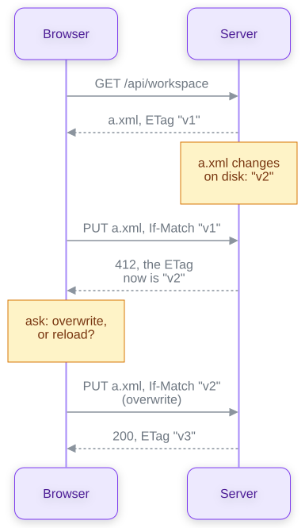
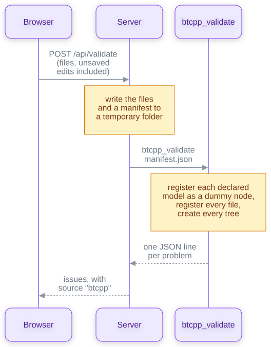
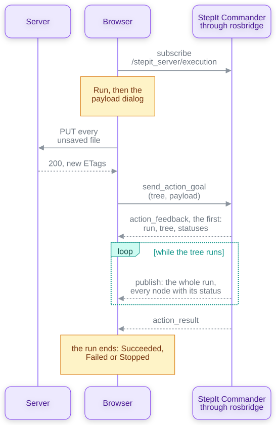

# StepIt Editor Architecture

## Table of Contents <!-- omit in toc -->

- [StepIt Editor Architecture](#stepit-editor-architecture)
  - [Introduction](#introduction)
  - [The Big Picture](#the-big-picture)
  - [The Layers](#the-layers)
  - [The Shared Core](#the-shared-core)
    - [The Document Model](#the-document-model)
    - [Parsing and Writing XML](#parsing-and-writing-xml)
    - [The Workspace Index](#the-workspace-index)
    - [The Editor's Checks](#the-editors-checks)
    - [Tree Operations](#tree-operations)
  - [The Server](#the-server)
    - [Saving Safely](#saving-safely)
  - [The Native Validator](#the-native-validator)
  - [The Client](#the-client)
    - [The Store](#the-store)
    - [From a Click to the Screen](#from-a-click-to-the-screen)
    - [Commands](#commands)
    - [Components](#components)
    - [Running a Tree](#running-a-tree)
  - [The Command Line Validator](#the-command-line-validator)
  - [Tests](#tests)
  - [How to Extend the Editor](#how-to-extend-the-editor)
  - [Design Decisions and Trade-offs](#design-decisions-and-trade-offs)

## Introduction

This document explains how the StepIt Editor is built, what each part is responsible for, and where to start when we want to change something. It assumes we have read the [README](../README.md) and used the editor once.

It follows one idea: **the XML files are the truth**. The editor reads them into a model, lets us change the model, and writes them back with what we wrote by hand kept, the comments and the elements it does not understand, so the files can still be edited by hand, reviewed in Git and loaded by the robot. The little that the model does not keep is listed under [Parsing and Writing XML](#parsing-and-writing-xml).

## The Big Picture

The editor is a single-page React application served by a small Node.js server. The server owns the folder of behaviors on disk; the browser holds everything else: the parsed files, the unsaved edits, the undo history and the checks.

<!-- The source is diagrams/big-picture.mmd: change it, then run bin/render-diagrams.sh. -->
<p align="center"></p>

- The **browser** talks to the server over a tiny JSON API: list the files, save one, delete one, validate, browse the folders, open another folder.
- The **server** reads and writes files, and runs the native validator when it is built. It does not parse behaviors for the editor: the browser does.
- The **native validator** is an optional C++ program that loads the files with BehaviorTree.CPP itself, the final word on whether a tree is valid.
- The **robot** is reached directly from the browser through rosbridge, not through our server, to run a tree.

The interface of the editor:

| Name | Type | What it does |
|---|---|---|
| `8080` | HTTP port, `PORT` | The production server ([`main.ts`](../src/server/main.ts)): the page built in `dist/` and the API. It listens on `HOST`, `0.0.0.0` by default, with no authentication. |
| `5173` | HTTP port | The Vite development server, with the same API ([`vite.config.ts`](../vite.config.ts)). |
| `/api/…` | HTTP routes | The folder of behaviors, see [The Server](#the-server). Described in OpenAPI at `/api/openapi.json`. |
| `BEHAVIORS_DIR` | environment variable | The folder opened first; without it, the examples in [`behaviors`](../behaviors). |
| `BEHAVIORS_BASE` | environment variable | The folder the *Open folder* dialog may browse; without it, the home folder of the server's user. |
| `BTCPP_VALIDATOR` | environment variable | The native validator to run; without it, `build/validator/btcpp_validate`. |
| `EDITOR_PORT` | environment variable | Only for the message at start: the port of the host that Docker publishes as the container's 8080. |
| `ws://<host>:9090` | rosbridge WebSocket, setting `rosbridgeUrl` | Where the browser reaches the robot; the host is the one that served the page. |
| `/commander/execute_objective` | `btcpp_ros2_interfaces/action/ExecuteTree` action, setting `runAction` | The goal of a run: `target_tree` and `payload`. Its feedback and its result come back. |
| `<action>/_action/cancel_goal` | `action_msgs/srv/CancelGoal` service | Called with an empty request to stop a run that another client started. |
| `/stepit_server/execution` | `std_msgs/msg/String` topic, setting `executionTopic` | Subscribed: the whole run as JSON, latched, whoever started it. |

The three settings are preferences of the browser, changed under *Connection* in the Run dialog (see [The Store](#the-store)).

## The Layers

The source code lives in [`src`](../src) and is split by where it runs:

| Folder | Runs in | Responsibility | May know |
|---|---|---|---|
| [`src/shared`](../src/shared) | Browser and Node.js | The model of a behavior file, the XML parser and writer, the workspace index, the checks, the tree edits. No I/O, no React. | Itself and xmldom. Nothing else. |
| [`src/server`](../src/server) | Node.js | The HTTP API over the folder, the production server, the runner of the native validator. | `shared`, the `node:` modules, `swagger-ui-dist`. |
| [`src/client`](../src/client) | Browser | The React user interface, its state and its commands. | `shared`, React, zustand, and the *types* of `server`. |
| [`src/cli`](../src/cli) | Node.js | The command line validator, for CI and pre-commit hooks. | `shared` and `server`. |
| [`validator`](../validator) | Native | The C++ program that loads the files with BehaviorTree.CPP. | BehaviorTree.CPP only: it shares no code with the rest, and talks through a JSON manifest and JSON lines. |

The dependencies point one way: everything may use `shared`, and `shared` uses nothing else. The diagram shows the imports as they are today; none breaks the rule.

<!-- The source is diagrams/packages.mmd: change it, then run bin/render-diagrams.sh. -->
<p align="center"></p>

The client imports a few *types* from the server, the shapes of the API responses, with `import type`, which the compiler erases: [`api.ts`](../src/client/api.ts), [`store/types.ts`](../src/client/store/types.ts) and [`FolderDialog.tsx`](../src/client/components/FolderDialog.tsx). It never imports its code, which would pull the `node:` modules into the browser. Outside `src`, [`vite.config.ts`](../vite.config.ts) imports the server to plug the API into the development server, and the tests import every layer.

To see the imports across the layers again:

```
grep -rnE "from '(\.\./)+(shared|server|client|cli)/" src
```

> [!IMPORTANT]
> Keep `src/shared` free of I/O, of `node:` modules and of React: it is bundled into the browser and run by Node.js. This is what lets the editor, the server and the CLI agree on what a valid behavior is.

## The Shared Core

### The Document Model

[`src/shared/types.ts`](../src/shared/types.ts) defines the in-memory model of a behavior file. It is worth reading first, since every other file speaks this language.

- A **`BTDocument`** is one XML file: the attributes of `<root>` (e.g. `BTCPP_format`, `main_tree_to_execute`) and a list of **items** in file order. An item is a `<BehaviorTree>`, a `<TreeNodesModel>`, a comment, or a **raw** element the editor does not understand, such as `<include>`, kept verbatim. The comments before and after `<root>`, e.g. a header that describes the file, are its `prolog` and `epilog`.
- A **`BehaviorTreeDef`** is a `<BehaviorTree>`: its ID, its attributes and its children.
- A **`BTNode`** is a node of a tree. Its `id` is the registration ID, e.g. `Sequence` or `MoveTo`, while its `tag` is the XML element name, which differs in the explicit form `<Action ID="MoveTo"/>`. Its `attrs` are the ports and special attributes (`name`, `_skipIf`…) in document order, its `comments` are the comments that precede it in the file, and its `trailingComments` those after its last child.
- A **`NodeModel`** is the declaration of a node type in a `<TreeNodesModel>`: its category (Action, Condition, Control, Decorator or SubTree) and its ports. Built-in nodes, such as `Sequence`, are node models too, flagged `builtin`.
- An **`Issue`** is a problem found by a check: its severity (error, warning or info), its message, where it is (file, tree, node, attribute, line), and its `source`, the editor's checks or BehaviorTree.CPP.

Every node and tree has a **`uid`**, e.g. `n42`, given by the parser, and by the tree operations to a node they create or copy. It identifies a node while we edit, for the selection, drag and drop and issues, but it is never written to the file, so reloading the folder gives new uids.

### Parsing and Writing XML

[`src/shared/xml.ts`](../src/shared/xml.ts) turns the text of a file into a `BTDocument` (`parseDocument`) and back (`serializeDocument`), with [xmldom](https://github.com/xmldom/xmldom) so that the same code runs in the browser and in Node.js.

The writer has one job: a file in the editor's own layout that the editor did not change must come back byte for byte. Comments are attached to the element after them, unknown elements are stored as raw XML, and the order of a node's attributes is kept. The layout is fixed: the XML declaration, two-space indentation, one element per line, a blank line between the items of `<root>`, `ID` first. The round-trip test runs every example in [`behaviors`](../behaviors) through the parser and the writer and expects the same text.

A file written by hand in another layout is therefore rewritten in the editor's layout the first time it is saved. It does not show as changed when it is opened: the editor compares a document with what it would have written when it was loaded, not with the text on disk (see [The Store](#the-store)).

The model does not keep everything. The parser reads elements and comments only, so these are dropped when a file is saved:

- inside a `<TreeNodesModel>`, the comments, and any element that is not `Action`, `Condition`, `Control`, `Decorator` or `SubTree`; inside a model, the comments, while its unknown elements are kept (`extraXml`) and its `<description>` is written after its ports;
- text between elements, CDATA sections, processing instructions and a `<!DOCTYPE>`.

`isGenerated` tells a file whose header comment contains the word "generated", e.g. the node models written from the C++ nodes: the editor shows the node types it declares, but does not let us change them.

### The Workspace Index

BehaviorTree.CPP applications usually register every file of a folder in one factory, so a tree may include a tree of another file, and a node type declared anywhere can be used everywhere. [`src/shared/workspace.ts`](../src/shared/workspace.ts) builds this view: `buildWorkspace` takes all the parsed files and indexes the trees by ID, the custom node models by ID, the SubTree interfaces and the built-in nodes.

A tree is an **objective** when it is the main tree of its file, its `main_tree_to_execute` (`isObjective`), and a **subtree** otherwise: it only runs when another tree includes it with a SubTree node, `subtreeCount` of them. The attribute is the only thing that decides, so a tree becomes one or the other in place, in any file of the folder. The list of the workspace, the Run button and the check `unusedSubtrees`, which reports a subtree that no tree includes, all read it the same way, and so does StepIt Commander, which refuses a goal for a subtree.

The `Workspace` is read-only and cheap to build: the client builds a new one after every edit rather than updating it. Helper functions answer the questions the UI asks, e.g. `modelOf` (what is this node?), `referencesTo` (which trees include this one?) and `usagesOf` (where is this node type used?).

The list of built-in nodes, with their ports and descriptions, lives in [`src/shared/builtins.ts`](../src/shared/builtins.ts). It is a fallback: when the native validator is built, the server asks BehaviorTree.CPP for the real list and sends that to the browser instead.

### The Editor's Checks

[`src/shared/validate.ts`](../src/shared/validate.ts) holds the first layer of validation, which runs after every edit. It reports what BehaviorTree.CPP would refuse when loading a tree (unknown nodes, wrong number of children, unknown ports, duplicate tree IDs, recursive SubTrees…) and a few things it only reports at runtime (input ports without a value, literals of the wrong type).

Each check is a **rule**: an object with a hook for each level it looks at, a file, a model, a tree, a node or the whole workspace. `validateWorkspace` walks the workspace once and calls the hooks of every rule in `RULES`, so a new check is a new rule in that list, 13 today, and a test can run one rule alone. A file that cannot be parsed is reported by the walk itself, as one error with the line of the parser, and skipped.

The checks are pure functions of the workspace: they return a list of `Issue`s and change nothing. An issue names the node at fault by its uid and, when it is about one attribute such as a port, that attribute too. The UI uses them to mark the rows, the files and the fields.

### Tree Operations

[`src/shared/treeOps.ts`](../src/shared/treeOps.ts) holds the edits of a tree: find a node by uid (`locate`), `insert`, `remove`, `move`, `shift`, `wrap`, `cloneNode`, disable a node through `_skipIf`. It also holds the edits of a whole document: add, delete or rename a tree, declare a node type. They mutate the document they are given; the store makes sure that is always a fresh copy (see [The Store](#the-store)). One that finds nothing to do returns `false`, so that no undo step is recorded.

[`src/shared/ids.ts`](../src/shared/ids.ts) checks the IDs of new trees and node types, and the paths of new files.

[`src/shared/payload.ts`](../src/shared/payload.ts) finds the entries of the global blackboard that a tree reads, i.e. every `{@key}` and `@key` in its ports and scripts and those of its SubTrees, which the Run dialog asks a value for. `payloadHints` describes each of them by the tree's own declaration, the ports of its `<SubTree>` model, one per entry, named after it: the description of the port goes under the field, and its example, the text after `e.g.` at the end of the description, in the field. The behaviors the tree uses have no say, so that building a behavior never changes what a Run dialog shows, and the editor knows nothing of them. The `payloadDeclared` rule warns when a tree with such a model reads an entry it does not declare, and adds an info note when a tree reads a payload without one: only a note, since a tree that reads the global blackboard is not necessarily one that is run on its own.

## The Server

[`src/server/api.ts`](../src/server/api.ts) is the whole HTTP API, written as a connect-style middleware so the same code serves both modes:

- in **development**, [`vite.config.ts`](../vite.config.ts) plugs it into the Vite dev server, which also serves the editor with hot reload (`bin/dev.sh`);
- in **production**, [`src/server/main.ts`](../src/server/main.ts) serves it together with the editor built in `dist/` (`bin/serve.sh`).

| Route | Purpose |
|---|---|
| `GET /api/workspace` | The folder, the content and the ETag of every behavior file in it, and the built-in nodes. |
| `PUT /api/files/a/b.xml` | Create (201) or overwrite (200) a file with the request body, if it is the version expected. |
| `DELETE /api/files/a/b.xml` | Delete a file, if it is the version expected. |
| `POST /api/validate` | Validate the given contents with BehaviorTree.CPP. |
| `GET /api/folders?path=/a` | The sub-folders of a folder, for the *Open folder* dialog. |
| `PUT /api/root` | Open another folder. |
| `GET /api/openapi.json` | The description of the routes above in OpenAPI 3.1, from [`openapi.ts`](../src/server/openapi.ts). |
| `GET /api/docs` | Swagger UI on that description, with three files of `swagger-ui-dist` under `/api/docs/`. |

Any other method on `/api/files/…` is answered 405, any other route 404, and a body over 10 MB 413. The production server answers every path outside `/api/` with the file of `dist/`, or with `index.html`.

The server is deliberately thin: it sends the files as text, and never parses them except to tell behaviors from other XML files and to write the manifest of the native validator. Finding and reading the files is in [`src/server/files.ts`](../src/server/files.ts), which the command line validator uses too: every `.xml` file of the folder and its sub-folders whose first element is `<root>`, leaving out hidden folders and `node_modules`. A file is written through a temporary file beside it, then renamed, so that a reader never sees half a file; the temporary name starts with a dot, which keeps it out of the list. The name is made of the process id and the millisecond, so two saves of one path in the same millisecond share it: [Review.md](Review.md) shows what that leaves on disk.

Every path from the browser goes through `safePath`, which refuses anything that is not a relative `.xml` path inside the folder. The check is on the text of the path: it does not resolve symbolic links, so a link inside the folder leads out of it. The *Open folder* dialog can only browse and open folders inside the home folder of the server's user, or inside `BEHAVIORS_BASE` when it is set, besides the folder the server started with.

### Saving Safely

A file can change on disk while it is open in the editor: someone edits it by hand, pulls from Git, or saves it from another tab. To never overwrite such a change unseen, writes use **optimistic concurrency** with HTTP conditional requests:

- the server gives each file an **ETag**, a SHA-256 hash of its content, when the editor loads it;
- saving sends the ETag of the version the edits are based on in `If-Match`, or `If-None-Match: *` for a new file, which must not exist yet;
- if the file on disk is not that version, the server answers **412 Precondition Failed** with the ETag of what is there now, and writes nothing.

<!-- The source is diagrams/saving-safely.mmd: change it, then run bin/render-diagrams.sh. -->
<p align="center"></p>

The editor then asks what to do (`saveFile` in [`actions.ts`](../src/client/actions.ts)): overwrite the change, which saves again over the version just seen and nothing newer, or reload the file and drop the edits. Deleting a file sends the same `If-Match`, but does not ask: a file changed on disk is not deleted, and the editor says to reload the folder first.

The server checks only what a request asks for: a `PUT` or a `DELETE` without `If-Match` or `If-None-Match` is unconditional, as HTTP has it. The safety is in the editor's client ([`src/client/api.ts`](../src/client/api.ts)), which always sends one of them; a new caller of the API must do the same.

The open folder is state of the server, shared by every tab connected to it. So every change also carries the folder its files were loaded from, in the `X-Behaviors-Root` header, and the server refuses it with **409 Conflict** if another tab opened another folder since (`checkRoot`). This too is checked only when the header is sent.

## The Native Validator

The editor's checks mirror BehaviorTree.CPP, but only the library knows for sure. [`validator/main.cpp`](../validator/main.cpp) is a small C++ program, built by `bin/build.sh` when the library is installed, that the server runs as a child process from [`src/server/native.ts`](../src/server/native.ts).

<!-- The source is diagrams/native-validator.mmd: change it, then run bin/render-diagrams.sh. -->
<p align="center"></p>

Because the application's C++ nodes are not available, the validator registers each node declared in a `<TreeNodesModel>` as a dummy with the declared ports. The library then checks the XML, the node types, the ports and the SubTrees exactly as it would on the robot. The dummy ports carry a direction and a default but no type, so the types of the values are checked by the editor only. The same program, run with `--builtins`, prints the library's built-in nodes as JSON.

The models of the manifest come from the editor's own parser, since the library has no API to read a `<TreeNodesModel>`. The program exits with 0, with 1 when it found an error, and with 2 when it could not run; the server gives it 60 seconds. What it prints that is not a finding, e.g. a crash, is shown as text under the result. An issue of the library names a file and a tree, never a node or a line: clicking it opens the tree.

If the program is not built, everything still works: the button *Check with BehaviorTree.CPP* is disabled and only the editor's checks run. A result is marked as stale once the files change after it.

## The Client

The client is a React 19 application in [`src/client`](../src/client), with its state in [zustand](https://github.com/pmndrs/zustand) stores. It has no router: one page, three panels, and two tabs in the centre one.

### The Store

[`src/client/store`](../src/client/store) holds the state of the editor: one zustand store made of four slices, described in its [`types.ts`](../src/client/store/types.ts).

| Slice | Holds |
|---|---|
| [`documents`](../src/client/store/documents.ts) | The files, their edits and undo history; loading, saving and validating. |
| [`navigation`](../src/client/store/navigation.ts) | What is selected, and the Back and Forward history between trees. |
| [`ui`](../src/client/store/ui.ts) | View state that is not part of any file: collapsed rows, the clipboard, toasts. |
| [`execution`](../src/client/store/execution.ts) | The run of the server, as it reports it, and whether the Execution tab is shown (see [Running a Tree](#running-a-tree)). |

The heart of it is one `FileState` per file:

- `raw`, the text on disk, and `baseline`, the text the editor would write for it when it was loaded or saved;
- `etag`, the version on disk that the edits are based on (see [Saving Safely](#saving-safely));
- `doc`, the current `BTDocument`, or `error` when the file cannot be parsed;
- `past` and `future`, the undo and redo stacks: previous documents;
- `isNew`, for a file created in the editor and not saved yet.

Documents are **never changed in place** once stored. Every change goes through `edit(path, change)`, which clones the current document with `structuredClone`, lets `change` mutate the clone with the tree operations, and stores the clone as the new document while pushing the old one on `past`. This gives undo for free, and lets React tell what changed by reference. Typing in a field passes a *coalesce key*, so that consecutive keystrokes make one undo step.

A file is **dirty** when it is new, or when its document, serialised, differs from the baseline. Serialising is cached per document in a `WeakMap`, which is safe precisely because documents are never mutated.

Reloading the folder keeps the unsaved edits, and the version they are based on: if their file changed on disk meanwhile, the editor says so, and saving will ask before overwriting it.

The preferences of the browser are in a second, small store in [`src/client/settings.ts`](../src/client/settings.ts), saved in `localStorage` under `be.settings`: the theme, the rosbridge URL, the action and the topic of the runs, the payload last used for each tree, and the tab of the left panel. The sizes of the panels are saved beside it, under `be.left`, `be.right` and `be.problems` (`useStoredSize` in [`Splitter.tsx`](../src/client/components/Splitter.tsx)). Nothing of the files is kept in the browser: unsaved edits are lost with the page, which asks before it closes.

### From a Click to the Screen

Nothing derived is stored: the workspace and its issues are computed from the files by the `useAnalysis` hook in [`src/client/hooks.ts`](../src/client/hooks.ts), memoised on the files and the built-in nodes. The `App` calls it once and passes the result down to the panels. One edit therefore flows like this:

<!-- The source is diagrams/click-to-screen.mmd: change it, then run bin/render-diagrams.sh. -->
<p align="center"></p>

This keeps the code simple, at the cost of rebuilding the index and re-running every check on every edit, which is fast for the tens of files a robot typically has.

### Commands

[`src/client/actions.ts`](../src/client/actions.ts) holds the commands: on the current selection (add, delete, move, cut, copy, paste, duplicate, wrap, disable), on trees (add, rename everywhere, delete), on node types (declare), and on files (save, with the conflict dialog). The toolbar, the keyboard shortcuts, the buttons on the rows and the panels all call the same functions, so a command behaves the same wherever it is triggered from.

A command reads the selection, calls `store.edit` with one or more operations of `shared`, then updates the selection, e.g. to select the node just added. The components render and call commands. A few commands still live in the components that use them (`Browser`, `TreeEditor`, `RunDialog`, `FolderDialog`), and the fields of the details panel are an exception of their own: they have no command of their own, and pass their change to `editNode` or `editTree` of `actions.ts`, or, for the ports of a node type (`ModelEditor` in [`Inspector.tsx`](../src/client/components/Inspector.tsx)), to `store.edit` itself. Either way the change goes through `edit`, so undo works the same.

The run in progress is kept by `actions.ts` too (`startRun`, `stopRun`), outside the store: it is a WebSocket, not state to show.

### Components

The screen is laid out in [`App.tsx`](../src/client/App.tsx), which also handles the global shortcuts (save, undo, Back and Forward) and warns before leaving with unsaved changes.

| Component | Panel | Responsibility |
|---|---|---|
| [`Browser`](../src/client/components/Browser.tsx) | Left | Two tabs: **Trees**, the objectives and the subtrees, each tree by its ID and never its file, except an empty or unreadable file; **Nodes**, the custom node types and the built-in nodes. Create and delete files; reload the folder; open another one. The tab shown is a setting, `browserTab`. |
| [`CenterTabs`](../src/client/components/CenterTabs.tsx) | Centre | The tabs of the centre panel: **Editor**, the `TreeEditor`, and **Execution**, the `ExecutionPanel`, which shows the name of the run, with a dot while it runs. |
| [`TreeEditor`](../src/client/components/TreeEditor.tsx) | Centre | The header, the toolbar, the tree or XML view, and the problems list. |
| [`TreeView`](../src/client/components/TreeView.tsx) | Centre | The tree as an indented list: selection, keyboard navigation, drag and drop, SubTrees expanded read-only. |
| [`XmlView`](../src/client/components/XmlView.tsx) | Centre | The XML that will be written, read-only. |
| [`Problems`](../src/client/components/Problems.tsx) | Centre | The issues of both validation layers; click one to select the node. The button that runs the native validator. |
| [`Inspector`](../src/client/components/Inspector.tsx) | Right | The details of the selection: a node's ports and scripts, a tree's ID and interface, or a node type and where it is used. A built-in node type, or one of a generated file, is shown but not edited. |
| [`AddNodeDialog`](../src/client/components/AddNodeDialog.tsx) | Dialog | The palette to add a node or a SubTree, wrap the selection, or declare a new node type. |
| [`RunDialog`](../src/client/components/RunDialog.tsx) | Dialog | The payload of a tree, before running it on the robot, and the connection: the rosbridge URL, the action and the topic. |
| [`FolderDialog`](../src/client/components/FolderDialog.tsx) | Dialog | The folders of the server, to open another one; it asks before dropping unsaved edits. |
| [`SettingsMenu`](../src/client/components/SettingsMenu.tsx) | Left | The theme. |
| [`ExecutionPanel`](../src/client/components/ExecutionPanel.tsx) | Centre | The run of the server, of this editor or started elsewhere: the status of each node, and what failed; Stop, which cancels the goal of a run of this editor, or every goal of the server for a run started elsewhere (`cancelAllGoals`). |
| [`Ports`](../src/client/components/Ports.tsx) | Shared | The ports of a node type, as shown by the details panel and by a file of node models. |

Dialogs are opened from anywhere with the promise-based helpers of [`dialogs.tsx`](../src/client/dialogs.tsx), e.g. `await confirm(...)` or `await choose(...)`, and rendered by a single `DialogHost`.

### Running a Tree

The Run button works on an objective only, and not while a run of this editor is going. The Run dialog saves every unsaved file, since the server runs the files on disk, and runs nothing if one could not be saved. Then [`src/client/ros.ts`](../src/client/ros.ts) opens a WebSocket to rosbridge and sends an `ExecuteTree` action goal to the BehaviorTree.ROS2 server with the tree ID and a YAML payload. The Execution tab then shows the run ([`ExecutionPanel`](../src/client/components/ExecutionPanel.tsx)): the tree as the server runs it, with the status of each node, and the result at the end. The editor needs no ROS installation: rosbridge speaks JSON. This is the longest flow of the editor, from a click to the result:

<!-- The source is diagrams/running-a-tree.mmd: change it, then run bin/render-diagrams.sh. -->
<p align="center"></p>

`ros.ts` knows the protocol of rosbridge and nothing of the editor. Each of its three functions opens a WebSocket of its own: `runTree` for one goal, closed with its result; `followExecution` for the topic, open as long as the page; `cancelAllGoals` for one service call, which gives up after 5 seconds.

**The statuses come from two sources** ([`execution.ts`](../src/client/execution.ts), [`store/execution.ts`](../src/client/store/execution.ts)). The feedback of the goal reaches only the client that sent it, and after its first message tells only what changed. So StepIt Commander also publishes the whole run, every node with its last status, on the latched topic `/stepit_server/execution`, which the editor follows from the moment it loads (`followExecution`, connecting again every 3 s when rosbridge goes away). A run of this editor is told apart on the topic by its number, which the first feedback message carries; from its first snapshot on, the snapshots give its statuses, so that a run looks the same whoever started it, and the feedback serves a server that publishes no run. A run started elsewhere shows once no run of this editor is running: it never replaces one. The goal's result, not the topic, ends a run of this editor, since only the goal tells a run that rosbridge could not even start.

When a run ends, a node still marked as running becomes halted: the server sends no last feedback when the tree is stopped or a node throws. A node that throws is found in the error message of the result (`failedNodeUid`) and shown as failed. A page reloaded during its own run no longer holds the goal: what the topic then publishes shows as a run started elsewhere.

## The Command Line Validator

[`src/cli/validate.ts`](../src/cli/validate.ts), run by `bin/validate.sh`, reads a folder with the server's file helpers, runs the editor's checks from `shared`, then the native validator when it is built, and prints the issues as text, or as JSON with `--json`. With `--editor-only` it skips the native validator. Its exit code is 1 on any error, for CI and pre-commit hooks.

## Tests

The tests are in [`tests`](../tests) and run with [Vitest](https://vitest.dev/) by `bin/test.sh`, after the type check and before `bin/check-diagrams.sh`, and in CI on every pull request and every push to `main` ([`.github/workflows/ci.yml`](../.github/workflows/ci.yml)).

| Test | Cases | What it covers |
|---|---|---|
| `xml.test.ts` | 12 | Parsing both XML forms, syntax errors with their line, the byte-for-byte round trip of every example, the comments kept, and telling a behavior file from other XML. |
| `validate.test.ts` | 20 | Each check, the attribute an issue names, custom rules, the examples being valid, and the broken files in [`tests/fixtures/broken`](../tests/fixtures/broken). |
| `treeOps.test.ts`, `workspace.test.ts`, `payload.test.ts` | 14, 9, 6 | The edits of trees and documents, the workspace queries, IDs and file names, and the payload of a tree. |
| `api.test.ts` | 20 | The HTTP API on a temporary folder: ETags, 412 and 409, paths and folders refused, bodies too large, and that the OpenAPI description names only routes that exist. |
| `native.test.ts` | 3 | Running the native validator, with a fake one in [`tests/fixtures/fake-validator`](../tests/fixtures/fake-validator). |
| `native-real.test.ts` | 6 | The native validator itself, built against BehaviorTree.CPP: what it accepts and rejects, and the built-in nodes it reports. It runs only where `BTCPP_VALIDATOR_REAL` names the built program, as in CI, and is skipped elsewhere. |
| `store.test.ts`, `actions.test.ts` | 15, 11 | Loading, undo, saving and conflicts, and the commands, against an in-memory server ([`fakeServer.ts`](../tests/fakeServer.ts)). |
| `execution.test.ts` | 28 | The feedback and the snapshots of a run, the executed tree with its subtrees, what made a run fail, and the execution slice: a run of this editor, a run started elsewhere, and the one that replaces the other. |
| `ros.test.ts` | 8 | The rosbridge protocol, with a fake WebSocket: the goal, its feedback and result, cancelling, following the topic and connecting again, stopping every goal. |
| `cli.test.ts` | 2 | The command line validator and its exit code, with `--editor-only`. |

That is 154 cases, as vitest counts them, each row of an `it.each` being one. One file alone: `pnpm exec vitest run tests/xml.test.ts`.

CI has two jobs. The first type-checks, tests, checks the diagrams and builds the editor. The second runs in a `ros:jazzy-ros-base` container: it builds the native validator against the ROS package of BehaviorTree.CPP, the library and the version the commander loads trees with, runs every test with the real validator, and validates the examples.

What has no automated test, and how to check it by hand:

- **The React components, the `App`, the dialogs and `useAnalysis`**: the tests run in Node.js without a DOM. They are thin over the commands and the store, which are tested. Start `bin/dev.sh`, open the examples, then add, move and delete a node, undo, save, and change a file on disk before saving to see the conflict dialog.
- **The production server** ([`main.ts`](../src/server/main.ts)) and the Vite plug-in: the tests call `createApi` directly. Run `bin/build.sh` and `bin/serve.sh`, and open `/` and `/api/docs`.
- **A real rosbridge and a real server**: `ros.test.ts` and `execution.test.ts` play their messages. Run an objective against a BehaviorTree.ROS2 server started with rosbridge, stop it, and start one from another client to see it in the Execution tab.
- **The parts of a file the model does not keep** (see [Parsing and Writing XML](#parsing-and-writing-xml)): the round-trip tests cover what is kept.
- **That every route is in the OpenAPI description**: the test checks the other direction only.

## How to Extend the Editor

| To… | Change… |
|---|---|
| add a check | a `Rule` in [`validate.ts`](../src/shared/validate.ts), added to `RULES`, and a case in `tests/validate.test.ts`. Name the `attribute` of an issue about one, so the field is marked. |
| support a new built-in node | [`builtins.ts`](../src/shared/builtins.ts): the node, and `childrenRange` if it takes a special number of children. With the native validator built, the ports come from the library anyway. |
| add an editing command | a pure operation in [`treeOps.ts`](../src/shared/treeOps.ts), a command in [`actions.ts`](../src/client/actions.ts) that calls it through `store.edit`, then a button or a shortcut. |
| add an API route | a branch in `createApi` in [`api.ts`](../src/server/api.ts), its description in [`openapi.ts`](../src/server/openapi.ts), a function in [`src/client/api.ts`](../src/client/api.ts), and its stand-in in [`tests/fakeServer.ts`](../tests/fakeServer.ts) when the store calls it. Use `safePath` for any path from the browser, and `checkRoot` for any change. |
| add a preference | `Settings` and `DEFAULTS` in [`settings.ts`](../src/client/settings.ts), and a control in `SettingsMenu`, or under *Connection* in `RunDialog` when it is about the robot. |
| show something new of a run | read it in `parseFeedback` and `parseSnapshot` of [`execution.ts`](../src/client/execution.ts), keep it in `Execution` ([`store/types.ts`](../src/client/store/types.ts)) from both sources in [`store/execution.ts`](../src/client/store/execution.ts), show it in `ExecutionPanel`, with a case in `tests/execution.test.ts`. |
| add a diagram to a document | a `.mmd` file in [`docs/diagrams`](diagrams), rendered with `bin/render-diagrams.sh` outside the container; commit the SVG with it. |
| keep something new in the XML | a field in [`types.ts`](../src/shared/types.ts), read by `parseDocument` and written by `serializeDocument`, with a round-trip test. |

## Design Decisions and Trade-offs

- **The browser parses, the server stores.** The server only moves text, so the checks run on unsaved edits without a round trip, and the same code validates in the browser and in CI.
- **Lossless round trip over a pretty model.** The model keeps comments, attribute order and unknown elements, which makes it a little noisier than a pure tree, but means opening and saving a file does not destroy hand-written content, with the exceptions listed in [Parsing and Writing XML](#parsing-and-writing-xml).
- **Immutable documents, whole-document undo.** Each edit stores a full copy of one file's document. It is simple and robust; the history is bounded to 200 steps per file.
- **Recompute rather than update.** The workspace index and the checks are rebuilt after every edit instead of being updated incrementally. This avoids a whole class of stale-state bugs, and is fast enough for the size of a robot's behaviors.
- **Optimistic concurrency.** Files are never locked while they are edited; a conflict is detected when saving, with ETags, and the user decides. Conflicts are rare for a folder of behaviors, and a lock would outlive a closed tab.
- **One folder per server.** The open folder is state of the server, shared by every browser tab connected to it: opening another folder in one tab changes it for the others too. Their changes are then refused rather than written to the wrong folder, and opening their folder again lets them save.
- **The browser talks to the robot, not the server.** A run goes from the page to rosbridge, so the server needs no ROS and the editor works on a folder with no robot at all. The price: the browser must reach port 9090 of the robot itself, and the server cannot tell what runs.
- **The server's snapshots over the goal's feedback.** A run looks the same in every editor and whoever started it, and a page opened in the middle of a run shows it. The feedback is kept for a server that publishes no run, which makes two paths to keep in step in [`store/execution.ts`](../src/client/store/execution.ts).
- **A tree describes its own payload.** The Run dialog reads the ports of the tree's `<SubTree>` model, never the behaviors the tree uses, so the editor needs nothing of the C++ nodes. The declaration is kept in step with the `{@key}` the tree reads by hand, with the `payloadDeclared` check to help.
- **Two validation layers.** The editor's checks are instant and precise about where the problem is; BehaviorTree.CPP is slower and optional, but authoritative. When they disagree, the library is right, and the editor's checks should be fixed.
